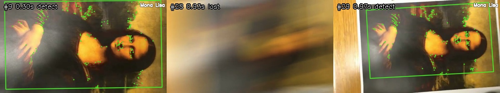
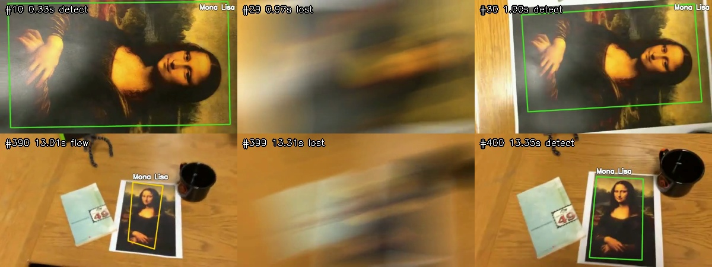
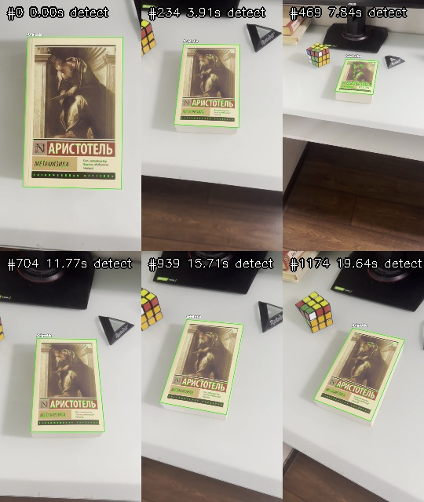

# Лабораторная работа №2. Трекинг объекта на видео

**Солодовников Данила Дмитриевич**

Цель работы — реализовать трекинг плоского объекта по ключевым точкам. Задание: [LW2_25.pdf](task/LW2_25.pdf).

## 1. Теоретическая база

**SIFT** выделяет характерные точки изображения и описывает окрестность каждой точки числовым дескриптором. Такие признаки позволяют сопоставлять объект при изменении масштаба и повороте. Для каждого дескриптора шаблона находятся два ближайших дескриптора кадра. Совпадение принимается, если расстояние до первого меньше `0.75` расстояния до второго — это проверка отношения расстояний Лоу.

**Гомография** описывает проективное преобразование плоскости. Она позволяет перенести четыре угла объекта из первого кадра в текущий:

$$
s\begin{bmatrix}x'\\y'\\1\end{bmatrix}
=H\begin{bmatrix}x\\y\\1\end{bmatrix}.
$$

Матрица $H$ имеет размер $3\times3$. Для её определения нужны как минимум четыре соответствия в невырожденном расположении. Метод **RANSAC** отбрасывает ошибочные соответствия. Точки, согласующиеся с найденным преобразованием, называются инлаерами.

**Оптический поток Лукаса — Канаде** отслеживает перемещение точек между соседними кадрами. Он помогает, когда объект становится маленьким или размытым и SIFT находит мало совпадений с первым кадром. Проверка перемещения вперёд и обратно отбрасывает ненадёжные точки.

## 2. Описание разработанной системы

Программа написана на Python и находится в файле [tracker.py](tracker.py). Используются OpenCV 4.11.0 и NumPy 2.2.6; версии зависимостей закреплены в [requirements.txt](requirements.txt).

### Общая схема

Эталоном служит выбранная область первого кадра. На каждом кадре программа определяет гомографию «эталон → текущий кадр» одним из двух способов:

- **Детекция:** объект находится сопоставлением признаков SIFT текущего кадра с эталоном. Этот поиск не зависит от результата предыдущего кадра и позволяет заново обнаружить объект после потери. Рамка рисуется зелёной.
- **Сопровождение:** точки объекта переносятся из предыдущего кадра в текущий методом оптического потока. Такой способ помогает при недостатке совпадений с эталоном, но зависит от предыдущего положения объекта и может накапливать ошибку. Рамка рисуется жёлтой.

По принятой гомографии четыре угла эталона переносятся на текущий кадр. Полученная рамка проходит геометрические проверки и рисуется вместе с подписью. Если подходящего преобразования нет, объект считается потерянным и рамка не выводится.

### Подготовка эталона (`Tracker.__init__`)

Для тестовых видео эталоном является весь первый кадр. В собственном видео книга занимает только часть изображения, поэтому четыре угла обложки вручную заданы в `BOOK_CORNERS`. Это начальная разметка: положение книги на остальных кадрах определяется автоматически. Для другого видео углы можно передать параметром `--corners`.

Проверяется, что углы находятся внутри изображения и образуют выпуклый четырёхугольник площадью не меньше 100 пикселей². Кадр переводится в оттенки серого. Внутри выбранной области создаётся белая маска, снаружи остаётся чёрный фон: признаки ищутся только на объекте.

SIFT настраивается на сохранение до 4000 признаков с порогом контраста `0.02`. Найденные ключевые точки и их дескрипторы сохраняются как постоянный эталон. Если точек меньше 10, программа прекращает обработку с сообщением о недостаточной текстуре объекта.

### Детекция (`Tracker.detect`)

1. На всём текущем кадре вычисляются точки и дескрипторы SIFT.
2. `BFMatcher` по евклидову расстоянию находит для каждого дескриптора эталона двух ближайших кандидатов в текущем кадре.
3. Применяется тест Лоу с порогом `0.75`: расстояние до лучшего кандидата должно быть меньше 75% расстояния до второго.
4. Если несколько точек эталона сопоставлены с одной точкой кадра, сохраняется только пара с наименьшим расстоянием между дескрипторами.
5. Координаты оставшихся пар передаются в `estimate()` для вычисления и проверки гомографии.

### Оценка гомографии (`Tracker.estimate`)

Метод получает соответствующие точки в координатах эталона и текущего кадра. Требуется не менее 10 пар. Гомография оценивается методом RANSAC с порогом ошибки проекции 3 пикселя, ограничением в 3000 итераций и параметром доверия `0.995`.

Результат принимается, если есть хотя бы 8 инлаеров, составляющих не менее 40% всех переданных соответствий. Дополнительно вычисляется `coverage`: отношение площади выпуклой оболочки инлаеров на эталоне к площади самого эталона. Оно должно быть не меньше 2,5%. Эта проверка отбрасывает случаи, когда все совпадения сосредоточены на маленькой детали и плохо определяют положение всей рамки.

Четыре угла преобразуются матрицей гомографии. Перед делением на третью однородную координату проверяется, что знаменатели не близки к нулю и имеют одинаковый знак. Затем проверяется геометрия полученного четырёхугольника.

Метод возвращает матрицу, число инлаеров и покрытие. Если любая проверка не пройдена, возвращается `(None, 0, 0)`.

### Сопровождение (`Tracker.follow`)

Точки для сопровождения выбираются в `locate()` после каждого успешного определения положения объекта, включая результаты оптического потока. Маска рамки сужается эрозией с ядром 5×5, чтобы уменьшить захват фона около границы. Функция `goodFeaturesToTrack` выбирает до 200 точек с уровнем качества `0.01`, минимальным расстоянием 3 пикселя и размером блока 3×3.

Если на следующем кадре требуется сопровождение:

1. Метод Лукаса — Канаде переносит точки из предыдущего кадра в текущий. Используется окно 21×21 и пирамида с максимальным уровнем 3.
2. Выполняется обратный перенос. Остаются точки, успешно найденные в обоих направлениях, с ошибкой возврата меньше 1 пикселя и ошибкой сравнения яркости участков меньше 20. Точки за пределами кадра удаляются.
3. Если осталось меньше 10 точек, сопровождение считается неудачным.
4. Координаты точек предыдущего кадра переводятся обратно в систему эталона с помощью обратной предыдущей гомографии.
5. По этим координатам и найденным положениям на текущем кадре `estimate()` вычисляет новую полную гомографию «эталон → текущий кадр».
6. Проверяется изменение площади рамки: отношение новой площади к предыдущей должно быть строго между `0.5` и `2`.

Таким образом, оба способа возвращают преобразование в одной системе координат. При достаточно уверенном обнаружении SIFT положение снова определяется непосредственно по первому кадру, что позволяет корректировать дрейф сопровождения.

### Проверка рамки (`Tracker.estimate`, `Tracker.follow`)

В `estimate()` результат отбрасывается, если:

- координаты содержат некорректные числа или четырёхугольник невыпуклый;
- площадь рамки не больше 100 пикселей² либо не меньше четырёх площадей кадра;
- длина хотя бы одной стороны меньше 5 пикселей;
- абсолютное значение любой координаты превышает четыре длины большей стороны кадра;
- внутри изображения находится меньше 10% площади рамки.

Эти проверки применяются и к детекции, и к сопровождению. Проверка изменения площади относительно прошлого кадра применяется только в `follow()`. Поэтому уверенная детекция может восстановить положение объекта даже после ошибки предыдущего сопровождения.

### Выбор результата на кадре (`Tracker.locate`)

1. Кадр переводится в оттенки серого, затем всегда выполняется детекция.
2. Если результат прошёл проверки, имеет не менее 20 инлаеров и покрытие не меньше 10%, принимается детекция.
3. Если результат отсутствует или не достигает этих порогов, а точки предыдущего кадра доступны, выполняется сопровождение. Успешное сопровождение заменяет результат детекции.
4. Если сопровождение не удалось, сохраняется результат детекции, если он прошёл основные проверки `estimate()`.
5. Если подходящей матрицы нет, возвращается режим `lost`, а состояние сопровождения сбрасывается. На следующих кадрах продолжается поиск через SIFT.
6. При успехе вычисляются углы рамки, сохраняются текущий кадр и гомография, заново выбираются точки для сопровождения следующего кадра.

### Отрисовка и обработка видео (`draw`, `process`, `main`)

`draw()` соединяет углы рамки и размещает возле верхней вершины белую подпись с чёрной обводкой. Цвет рамки показывает способ определения положения объекта.

`process()` читает видео последовательно, ограничивает длинную сторону кадра 1280 пикселями и пересчитывает координаты начальной области. Для каждого кадра вызываются `locate()` и, при обнаружении объекта, `draw()`. Обработанные кадры записываются в MP4; отдельно подсчитываются детекции, результаты сопровождения и потери.

Для README сохраняются обзорные кадры. В тестах с размытием выбраны моменты до потери, во время размытия и после восстановления. Эти номера управляют только выбором скриншотов: трекинг выполняется на каждом кадре.

`main()` читает параметры командной строки, выбирает видео и подпись, запускает обработку и сохраняет статистику в `results/stats.json`.

### Запуск

```bash
python tracker.py
```

Без аргументов обрабатываются три тестовых ролика и собственное видео `IMG_8805.mp4`.

Обработка одного файла с отображением результата:

```bash
python tracker.py task/test-videos/mona-lisa.mp4 --show
python tracker.py task/test-videos/IMG_8805.mp4
```

Для другого видео можно указать подпись и углы объекта на первом кадре. Координаты задаются в исходном разрешении последовательно по периметру:

```bash
python tracker.py my_video.mp4 --label Book --corners 100 80 500 80 500 700 100 700
```

## 3. Результаты работы и тестирования

Проверены все кадры трёх тестовых роликов и собственного видео.

| Видео                           | Кадров | SIFT | Поток | Пропуски | Кадры с рамкой | Обработка, кадр/с |
| ------------------------------- | -----: | ---: | ----: | -------: | -------------: | ----------------: |
| mona-lisa.mp4                   |    558 |  174 |   384 |        0 |        100.00% |              37.9 |
| mona-lisa-blur.mp4              |    558 |  148 |   391 |       19 |         96.59% |              37.2 |
| mona-lisa-blur-extra-credit.mp4 |    558 |  136 |   394 |       28 |         94.98% |              37.3 |
| IMG_8805.mp4                    |   1186 | 1186 |     0 |        0 |        100.00% |               9.3 |

**Обычное тестовое видео:** [результат](results/mona-lisa_tracked.mp4).


**Видео с размытием:** [результат](results/mona-lisa-blur_tracked.mp4).



**Видео с экстра размытием:** [результат](results/mona-lisa-blur-extra-credit_tracked.mp4).



**Собственное видео:** [результат](results/IMG_8805_tracked.mp4).



## 4. Выводы по работе

Реализован трекер плоского объекта по ключевым точкам. SIFT позволяет узнавать объект по первому кадру, а оптический поток поддерживает трекинг между надёжными обнаружениями. Гомография учитывает перспективу, поэтому рамка поворачивается и меняет форму вместе с объектом.

На собственном видео текстурная обложка достаточно крупная, что облегчает сопоставление. В тестах основными затруднениями оказались уменьшение объекта и размытие. При недостатке надёжных точек возникают пропуски. Метод также ограничен предположением о плоском объекте и может терять его при сильном перекрытии или резком движении.
