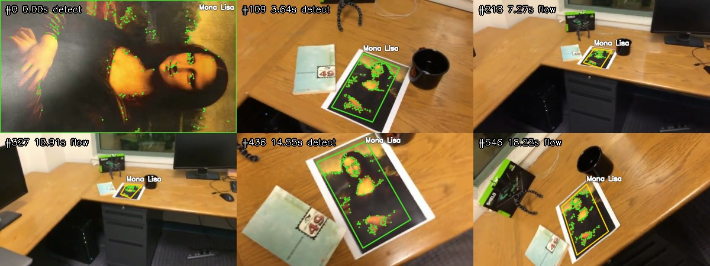

# Лабораторная работа №2. Трекинг объекта на видео

**Солодовников Данила Дмитриевич**

Цель работы — реализовать трекинг плоского объекта по ключевым точкам. Задание: [LW2_25.pdf](task/LW2_25.pdf).

## 1. Теоретическая база

**SIFT** выделяет характерные точки изображения и описывает окрестность каждой точки числовым дескриптором. Такие признаки позволяют сопоставлять объект при изменении масштаба и повороте. Для каждого дескриптора шаблона находятся два ближайших дескриптора кадра. Совпадение принимается, если расстояние до первого меньше `0.75` расстояния до второго — это проверка отношения расстояний Лоу.

**Гомография** описывает проективное преобразование плоскости. Она позволяет перенести четыре угла объекта из первого кадра в текущий:

$$
s\begin{bmatrix}x'\\y'\\1\end{bmatrix}
=H\begin{bmatrix}x\\y\\1\end{bmatrix}.
$$

Матрица $H$ имеет размер $3\times3$. Для её определения нужны как минимум четыре соответствия в невырожденном расположении. Метод **RANSAC** отбрасывает ошибочные соответствия. Точки, согласующиеся с найденным преобразованием, называются инлаерами.

**Оптический поток Лукаса — Канаде** отслеживает перемещение точек между соседними кадрами. Он помогает, когда объект становится маленьким или размытым и SIFT находит мало совпадений с первым кадром. Проверка перемещения вперёд и обратно отбрасывает ненадёжные точки.

## 2. Описание разработанной системы

Программа написана на Python с использованием OpenCV и NumPy. Весь код находится в [tracker.py](tracker.py) и разделён на функции подготовки видео, поиска объекта и сохранения результатов.

### Общая схема

Эталоном служит область первого кадра. Положение объекта определяется двумя способами:

- **Детекция:** SIFT сопоставляет детали текущего кадра с эталоном. Рамка зелёная.
- **Сопровождение:** оптический поток переносит точки с предыдущего кадра. Рамка жёлтая.

По найденной гомографии четыре исходных угла переносятся на текущий кадр. Если надёжного результата нет, рамка не рисуется, а поиск продолжается на следующих кадрах.

### Подготовка эталона (`prepare_template`, `Tracker.__init__`)

Для собственного видео начальные углы обложки вручную заданы в `BOOK_CORNERS`. Для остальных видео без параметра `--corners` используется весь первый кадр. `prepare_template()` проверяет углы, ограничивает длинную сторону изображения 1280 пикселями и пересчитывает координаты.

В конструкторе трекера кадр переводится в оттенки серого, а область объекта выделяется маской. SIFT сохраняет до 4000 признаков с порогом контраста `0.02`. Ключевые точки и дескрипторы становятся постоянным эталоном; требуется минимум 10 точек.

### Детекция (`Tracker.detect`)

1. На текущем кадре вычисляются признаки SIFT.
2. `BFMatcher` находит два ближайших дескриптора для каждого признака эталона.
3. Тест Лоу с порогом `0.75` отбрасывает неоднозначные совпадения. Повторное использование одной точки кадра исключается.
4. Координаты оставшихся пар передаются в `estimate()`.

### Оценка гомографии (`Tracker.estimate`)

По минимум 10 соответствиям RANSAC вычисляет гомографию с порогом ошибки 3 пикселя. Требуется хотя бы 8 инлаеров, составляющих не менее 40% всех пар.

Также проверяется покрытие объекта: выпуклая оболочка инлаеров на эталоне должна занимать не меньше 2,5% его площади. Это исключает совпадения, сосредоточенные на одной маленькой детали. Метод возвращает матрицу, число инлаеров и покрытие.

### Сопровождение (`Tracker.select_points`, `Tracker.follow`)

После каждого успешного определения положения `select_points()` выбирает внутри рамки до 200 точек. Маска немного сужается, чтобы уменьшить захват фона.

При недостаточно уверенной детекции `follow()` переносит точки методом Лукаса — Канаде и выполняет обратный поиск. Отбрасываются точки с ошибкой возврата от 1 пикселя, ошибкой сравнения яркости от 20 или положением за пределами кадра.

Если осталось хотя бы 10 точек, их старые координаты переводятся в систему эталона обратной предыдущей гомографией. Затем `estimate()` вычисляет новую гомографию «эталон → текущий кадр».

### Проверка рамки (`is_valid_box`, `Tracker.follow`)

`is_valid_box()` проверяет корректность координат, выпуклость, площадь и длины сторон рамки. Хотя бы 10% её площади должно находиться внутри кадра. При сопровождении дополнительно требуется, чтобы отношение новой площади к предыдущей было строго между `0.5` и `2`.

### Выбор результата (`Tracker.locate`)

1. Сначала всегда выполняется детекция.
2. Результат с минимум 20 инлаерами и покрытием от 10% принимается сразу, если прошёл проверки.
3. При более слабом результате и наличии предыдущих точек пробуется сопровождение. Если оно не удалось, сохраняется допустимый результат детекции.
4. Если подходящей матрицы нет, возвращается режим `lost` и сопровождение сбрасывается.
5. При успехе вычисляются углы рамки и обновляются точки для следующего кадра.

### Обработка и сохранение (`main`, `process`, `draw`)

`main()` выбирает видео, подпись и начальные углы. `process()` подготавливает трекер и запускает цикл: чтение кадра → `locate()` → `draw()` → запись в MP4. `draw()` рисует рамку, подпись и зелёные точки внутри объекта. Это точки, выбранные `select_points()` для оптического потока. Они показываются после выполнения поиска и не влияют на вычисление положения объекта.

Создание выходного файла вынесено в `create_writer()`, а выбор и сохранение скриншотов — в `choose_samples()`, `make_sample()` и `save_samples()`. Для роликов с размытием сохраняются моменты до потери, во время неё и после восстановления. Выбор скриншотов не влияет на трекинг. Статистика записывается в `results/stats.json`.

### Запуск

```bash
python tracker.py
```

Без аргументов обрабатываются три тестовых ролика и собственное видео `IMG_8805.mp4`.

Обработка одного файла с отображением результата:

```bash
python tracker.py task/test-videos/mona-lisa.mp4 --show
python tracker.py task/test-videos/IMG_8805.mp4
```

Для другого видео можно указать подпись и углы объекта на первом кадре. Координаты задаются в исходном разрешении последовательно по периметру:

```bash
python tracker.py my_video.mp4 --label Book --corners 100 80 500 80 500 700 100 700
```

## 3. Результаты работы и тестирования

Проверены все кадры трёх тестовых роликов и собственного видео.

| Видео                           | Кадров | SIFT | Поток | Пропуски | Кадры с рамкой | Обработка, кадр/с |
| ------------------------------- | -----: | ---: | ----: | -------: | -------------: | ----------------: |
| mona-lisa.mp4                   |    558 |  174 |   384 |        0 |        100.00% |              35.0 |
| mona-lisa-blur.mp4              |    558 |  148 |   391 |       19 |         96.59% |              35.5 |
| mona-lisa-blur-extra-credit.mp4 |    558 |  136 |   394 |       28 |         94.98% |              33.8 |
| IMG_8805.mp4                    |   1186 | 1186 |     0 |        0 |        100.00% |              10.1 |

**Обычное тестовое видео:** [результат](results/mona-lisa_tracked.mp4).



**Видео с размытием:** [результат](results/mona-lisa-blur_tracked.mp4).


**Видео с экстра размытием:** [результат](results/mona-lisa-blur-extra-credit_tracked.mp4).


**Собственное видео:** [результат](results/IMG_8805_tracked.mp4).


## 4. Выводы по работе

Реализован трекер плоского объекта по ключевым точкам. SIFT позволяет узнавать объект по первому кадру, а оптический поток поддерживает трекинг между надёжными обнаружениями. Гомография учитывает перспективу, поэтому рамка поворачивается и меняет форму вместе с объектом.

На собственном видео текстурная обложка достаточно крупная, что облегчает сопоставление. В тестах основными затруднениями оказались уменьшение объекта и размытие. При недостатке надёжных точек возникают пропуски. Метод также ограничен предположением о плоском объекте и может терять его при сильном перекрытии или резком движении.
